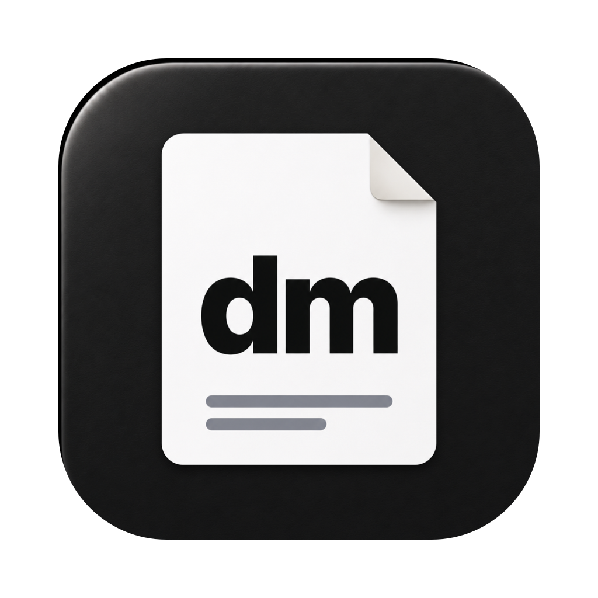
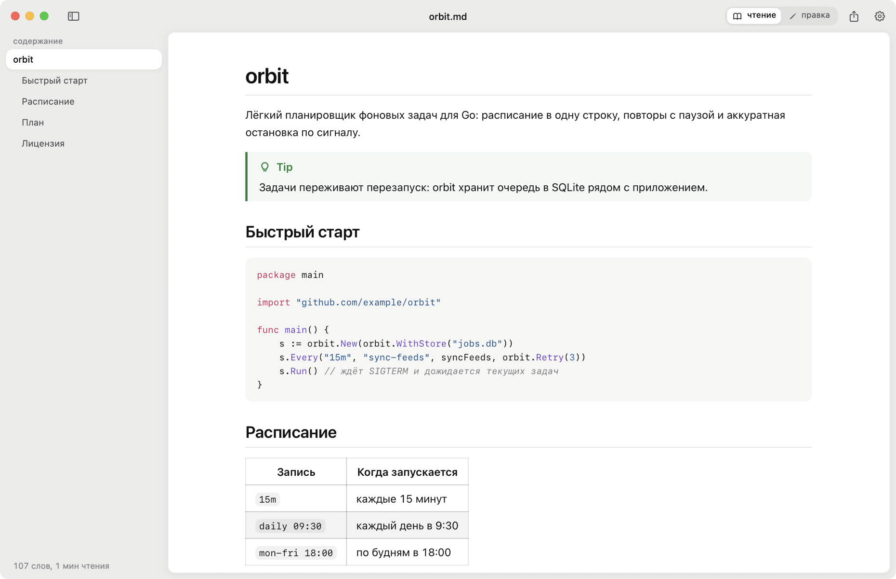
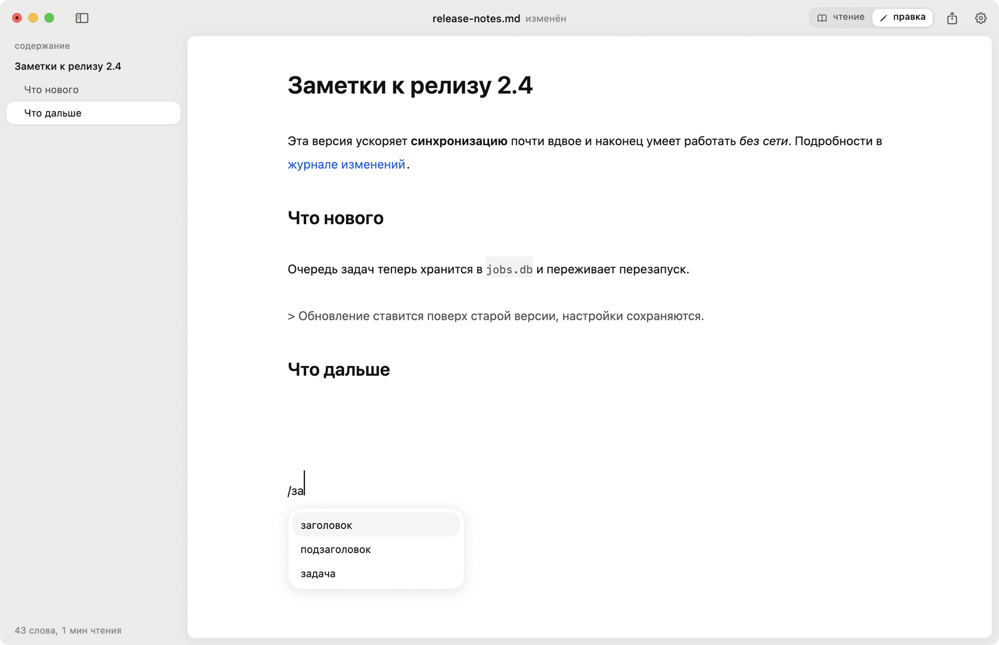

<p align="center">
  
</p>

<h1 align="center">rotide.dm</h1>

<p align="center">
  <strong>Красивый и лёгкий редактор Markdown</strong><br>
  Читайте и правьте <code>.md</code> в одном окне: матовое стекло, светлая и тёмная тема, плавные анимации, свой размер текста и иконка.
</p>

<p align="center">
  <a href="https://github.com/workedErnesto/rotide.dm/releases/latest"></a>
  
  
  <a href="LICENSE"></a>
  <br>
  
  
  
  
  
</p>

<h3 align="center">
  <a href="https://github.com/workedErnesto/rotide.dm/releases/latest">скачать для macOS</a>
  &nbsp;|&nbsp;
  <a href="https://github.com/workedErnesto/rotide.dm/releases/latest">скачать для Windows</a>
</h3>

<p align="center">
  <a href="#почему-rotidedm">почему rotide.dm</a> |
  <a href="#возможности">возможности</a> |
  <a href="#горячие-клавиши">горячие клавиши</a> |
  <a href="#установка">установка</a> |
  <a href="#сборка-из-исходников">сборка</a>
</p>

<p align="center">
  <picture>
    <source media="(prefers-color-scheme: dark)" srcset="docs/screenshots/read-dark.png">
    
  </picture>
</p>

## Почему rotide.dm

<table>
  <tr>
    <td width="50%" valign="top">
      <strong>Красиво</strong><br>
      Матовая оболочка macOS и Acrylic на Windows 11, спокойная системная типографика, плавные анимации на пружинах. С Reduce Motion движение сменяется мягким проявлением.
    </td>
    <td width="50%" valign="top">
      <strong>Легко</strong><br>
      Нативное приложение без Electron: установщик весит 15–23 МБ, без аккаунтов и подписок, файлы остаются на вашем диске.
    </td>
  </tr>
  <tr>
    <td width="50%" valign="top">
      <strong>Под себя</strong><br>
      Системная, светлая или тёмная тема, интерфейс на русском или английском, прозрачность стекла, размер текста, строчные или прописные подписи и шесть иконок приложения.
    </td>
    <td width="50%" valign="top">
      <strong>Чтение и правка в одном окне</strong><br>
      ⌘1 читаете, ⌘2 пишете: оформление видно прямо в тексте, <code>/</code> вставляет нужную конструкцию. Документ выглядит как на GitHub, а PDF, Word или HTML получаются в пару щелчков.
    </td>
  </tr>
</table>

<p align="center">
  
  <br>
  <sub>Правка: оформление видно сразу, маркеры Markdown спрятаны. Ввод после <code>/</code> фильтрует команды.</sub>
</p>

## Возможности

### Чтение

| Возможность | Подробности |
|---|---|
| Диалект GitHub | таблицы, зачёркивание, автоссылки, задачи, сноски, сырой HTML (`<details>`, `<kbd>`, центрированные логотипы) |
| Дополнения GitHub | алерты `NOTE`, `TIP`, `IMPORTANT`, `WARNING`, `CAUTION`, эмодзи `:rocket:`, якоря заголовков |
| Подсветка кода | Swift, JS/TS, Python, Go, Rust, C/C++, Java/Kotlin, Ruby, PHP, shell, SQL, JSON, YAML, TOML, HTML/XML, CSS, diff и другие |
| Картинки | по относительным путям, в том числе из родительских папок (`../images/logo.png`) |
| Навигация | оглавление с подсветкой текущего раздела, число слов и время чтения; ссылки на другие `.md` открываются в rotide.dm |

### Правка

| Возможность | Подробности |
|---|---|
| Оформление в тексте | заголовки и основные строчные элементы выглядят как в готовом документе, их маркеры скрыты |
| Команды по `/` | заголовок, список, задача, цитата, код, ссылка, таблица и другие заготовки; стрелки выбирают, Enter вставляет |
| Поиск и замена | ⌘F и ⌥⌘F, с переходом по совпадениям |
| Сохранность | отмена правок, возврат к сохранённому; файл, изменённый другой программой, перечитывается сам, если в окне нет несохранённых правок |

### Форматы

| Открывает и правит | Экспортирует |
|---|---|
| Markdown (`.md`, `.markdown` и родственные) | HTML: один файл, локальные картинки встроены |
| Word `.docx`: заголовки, списки, таблицы, ссылки, код | PDF в светлой теме |
| RTF | Word `.docx`: стили заголовков, настоящие списки, таблицы, код с подсветкой, картинки |
| простой текст (`.txt`, `.log` и любой текстовый файл) | RTF и простой текст |

Word и RTF правятся через Markdown. Перед первым сохранением поверх такого файла rotide.dm спрашивает, собрать ли его заново или сохранить копию в Markdown.

### Оформление

Системная, светлая или тёмная тема, язык интерфейса (русский или английский: по умолчанию как в системе, при смене текст плавно перетекает), матовое стекло с настраиваемой прозрачностью, размер текста документа и шесть вариантов иконки приложения. Недавние файлы видны в стартовом окне, в меню значка в Dock и в списке переходов панели задач Windows.

## Горячие клавиши

| Действие | macOS | Windows |
|---|---|---|
| чтение и правка | ⌘1, ⌘2 | Ctrl+1, Ctrl+2 |
| команды вставки | `/` в начале строки | `/` в начале строки |
| найти, найти и заменить | ⌘F, ⌥⌘F | Ctrl+F, Ctrl+H |
| оглавление | ⌃⌘S | Ctrl+Alt+S |
| масштаб | ⌘+, ⌘−, ⌘0 | Ctrl+=, Ctrl+-, Ctrl+0 |
| сохранить, сохранить как | ⌘S, ⇧⌘S | Ctrl+S, Ctrl+Shift+S |
| напечатать | ⌘P | Ctrl+P |
| настройки | ⌘, | Ctrl+, |

## Установка

Скачайте файл для своей системы со страницы [последнего релиза](https://github.com/workedErnesto/rotide.dm/releases/latest).

| Система | Файл |
|---|---|
| macOS 15 и новее, Apple silicon и Intel | `rotide.dm-<версия>.dmg`: откройте и перетащите rotide.dm в «Программы» |
| Windows 10 и 11, x64 | `rotide.dm-<версия>-win-x64-setup.exe` |
| Windows 11, ARM | `rotide.dm-<версия>-win-arm64-setup.exe` |

> [!NOTE]
> Сборки пока не подписаны. На macOS при первом запуске разрешите rotide.dm в «Системных настройках», раздел «Конфиденциальность и безопасность». На Windows в окне SmartScreen нажмите «Подробнее», затем «Выполнить в любом случае». Установщик Windows не требует прав администратора.

<details>
<summary><strong>Как открывать Markdown в rotide.dm по умолчанию</strong></summary>
<br>

**macOS.** rotide.dm регистрируется основным приложением для Markdown (`.md`, `.markdown`, `.mdown`, `.mkd`, `.mkdn`, `.mdwn`, `.mdtxt`, `.mdtext`) и дополнительным для `.txt`, `.text`, `.docx` и RTF. Если `.md` уже открывается другой программой, выберите файл в Finder, нажмите ⌘I, в разделе «Открывать в программе» выберите rotide.dm и нажмите «Изменить всё».

**Windows.** Установщик связывает Markdown с rotide.dm (галочку можно снять) и добавляет его в «Открыть с помощью» для `.txt`, `.text`, `.docx` и `.rtf`. Если раньше для `.md` было выбрано другое приложение кнопкой «Всегда», выберите rotide.dm в «Параметры», «Приложения», «Приложения по умолчанию».

</details>

## Честно об ограничениях

1. В режиме правки таблицы, картинки, HTML и сложные конструкции показываются исходным Markdown; полное оформление в режиме чтения.
2. Диаграммы Mermaid и формулы LaTeX пока показываются блоками кода.
3. Проверки орфографии нет: Flutter на компьютерах её не предоставляет.
4. При сохранении поверх Word или RTF пропадает то, чего нет в Markdown: шрифты, цвета, выравнивание, картинки, колонтитулы, примечания и исправления. Старые `.doc`, `.odt` и Pages не открываются.

## Сборка из исходников

rotide.dm написан на Flutter: одна кодовая база для macOS и Windows, нативные части на Swift и C++. Нужны Flutter 3.47.5 и Xcode (macOS) или Visual Studio с компонентом «Desktop development with C++» (Windows).

```bash
scripts/build_macos.sh release
```

```bash
cd app && flutter build windows --release
```

<details>
<summary><strong>Все скрипты, тесты и устройство проекта</strong></summary>
<br>

| Команда | Что делает |
|---|---|
| `scripts/qa_macos.sh debug` | собирает и открывает тестовую копию `build/rotide.dm QA.app` с отдельным идентификатором |
| `scripts/build_macos.sh release` | собирает `app/build/macos/Build/Products/Release/rotide.dm.app` |
| `scripts/install_macos.sh` | прогоняет тесты, собирает release и заменяет `/Applications/rotide.dm.app` (настройки и история сохраняются) |
| `scripts/dmg_macos.sh` | прогоняет тесты, собирает release и упаковывает `build/rotide.dm-<версия>.dmg` с файлом `.sha256` |
| `cd packages/rotide_core && dart test` | тесты ядра |
| `cd app && flutter test` | тесты приложения |

Установщик Windows собирает [Inno Setup](https://jrsoftware.org/isinfo.php) по скрипту `app/windows/installer/rotide.iss`. Workflow `.github/workflows/windows.yml` на каждый пуш собирает и тестирует x64 и ARM, ставит установщик, проверяет связь с `.md` и запуск приложения.

| Часть | Содержимое |
|---|---|
| `packages/rotide_core` | рендер Markdown (cmark-gfm через FFI), оглавление, подсветка кода, DOCX и RTF, история файлов; чистый Dart, покрыт тестами |
| `packages/rotide_ui_kit` | токены и компоненты дизайн-системы |
| `packages/rotide_native` | мост к нативному слою и его macOS-часть на Swift: окна, матовое стекло, меню, Dock, WKWebView, печать |
| `app` | приложение на Flutter и раннеры: `app/macos`, `app/windows/runner` (C++: окна, Acrylic, реестр, WebView2, печать) |
| `DESIGN.md` | дизайн-система и то, как сохранён внешний вид исходной Swift-версии |

</details>

## Лицензия

[MIT](LICENSE). Встроенный разборщик cmark-gfm распространяется по своей лицензии, см. `packages/rotide_core/third_party/cmark-gfm/COPYING`.
